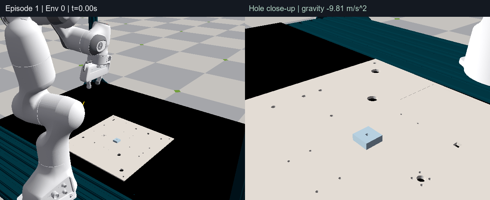
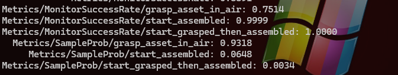
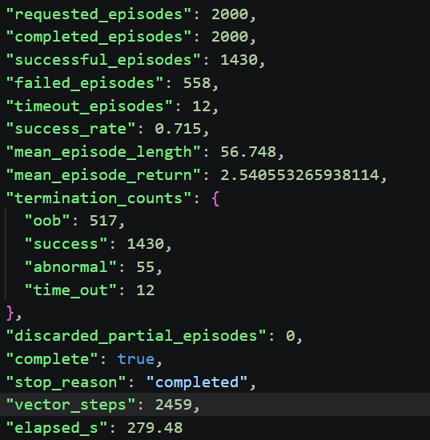

### 实现的任务



空中抓取销->插到孔中

4 mm 方销，配套 NIST `rectangular_hole_4mm.usd` 方孔（4 mm 规格，实际孔宽和配合间隙以 USD 模型为准），成功需要同时满足：

- 姿态对齐：在目标装配坐标系中，销的 roll、pitch 角分别归一化到 `[-π, π]` 后，绝对值之和小于 `0.025 rad`（约 `1.43°`）；成功判定不单独检查 yaw。
- 横向对中：销尖相对目标装配位置的 XY 平面距离小于 `0.0025 m`（`2.5 mm`）。
- 插入到位：销尖相对目标装配位置的有符号 Z 距离小于 `0.001 m`（`1 mm`）。孔口位于该坐标系的 `z = 9 mm`，因此相当于插入深度大于 `8 mm`；代码没有对 Z 距离取绝对值。

上述阈值见 `src/peginsert/tasks/pegact/mdp/terminations.py` 和 `src/peginsert/tasks/pegact/config/franka/env_cfg.py`，满足三个条件即触发成功终止，无需额外保持一段时间。

较为严苛，所以训练出来很♂（

### 需要的软件和硬件环境

#### 软件

Isaac Lab这个任务可以兼容两种物理后端依赖Kit的Isaac Sim PhysX和NV和Google合作的搞出来的Newton

Newton不依赖Kit在训练和验证时的推理表现都很出色。

本项目主要采用

#### 硬件

用于训练  3080 20G/4090D 24G/3090 24G，（穷学生能搞到这些不错了

用于evalue

### PPO+课程学习

PPO是个好算法（好吧其实on policy数据利用率有点低了，个人感觉SAC的数据利用率更高一些，off policy的优点

PPO的核心就是用广义优势估计替换策略梯度方法里的G，用策略比替换掉策略梯度方法里的策略输出概率对数，再辅以裁剪，避免更新过大

至于critic网络，是从时序差分推出来的，但是目标每一轮都是固定的R，R由旧V网络和广义优势相加得到

课程学习，构造了一个根据初态悬着概率分布，有三个初态重置策略，按难度从高到底分别是：grasp_asset_in_air start_assembled start_grasped_then_assembled

根据他们的最近的成功概率，去调整环境的重置时选择它们三类的重置概率。同时当平均成功率大于0.8难度开始增加，难度指的时重力大小。

### 最后的评估

只评估grasp_asset_in_air这一初态下的场景，seed 12345与训练的seed 45区分

#### 训练成功率



#### 测试成功率（2000 episodes）

```powershell
uv run python scripts/evaluate.py --checkpoint logs\rsl_rl\peg_inset\2026-11-13_09-18-28_dense_reward_resume_curriculum_4090_0.7V2\model_36600.pt --headless --episodes 2000 --num_envs 64 --seed 12345
```
可能因为训练时间和算力的限制，目前成功率0.71，也有可能PPO的上限就如此了，因为后面提升很缓慢。
后面想到的方案有预训练Q网络，提前标定价值（学长给的建议，SAC增加探索性，大力砖飞（继续增加并行规模现在是4096，增加训练时间）
成功率 0.71左右


