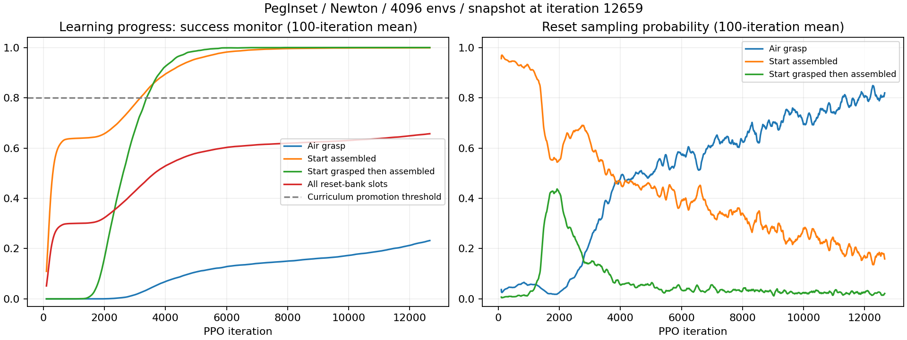

# 当前 Newton 长训练诊断及公开成功证据

快照时间：2026-11-10T16:10:08.412143+08:00。训练目录：`logs/rsl_rl/peg_inset/2026-11-07_13-29-01`。本次只读取训练数据和代码，未修改或中断正在运行的训练。

## 当前状态

已记录 12660/15000 次迭代，最后迭代编号 12659，进度 84.4%。确认命令使用 PegInset、Newton+MuJoCo Warp、4096 环境、种子 42、原默认 PPO。全体日志标量均有限。

| 指标 | 快照最后值 | 最后100次迭代均值 |
| --- | ---: | ---: |
| 全状态库成功监测值 | 65.77% | 65.71% |
| 空中抓持类别 | 23.35% | 23.20% |
| 已装配类别 | 99.90% | 99.90% |
| 先抓持再装配类别 | 100.00% | 99.99% |
| Episode_Termination/success | 85.36% | 83.84% |
| 难度 | 0 | 0 |

上表是训练日志的监测量，不能替代独立评测成功率。

| 迭代编号 | 空中抓持 | 已装配 | 先抓持再装配 | 全状态库均值 |
| --- | ---: | ---: | ---: | ---: |
| 0 | 0.00% | 1.36% | 0.00% | 0.64% |
| 1000 | 0.00% | 63.86% | 0.02% | 30.03% |
| 3000 | 1.84% | 78.26% | 68.99% | 43.40% |
| 5000 | 10.84% | 95.62% | 98.74% | 58.08% |
| 8000 | 15.09% | 99.61% | 99.99% | 61.95% |
| 10000 | 17.36% | 99.81% | 99.99% | 63.06% |
| 12000 | 21.42% | 99.89% | 99.99% | 64.90% |
| 12659 | 23.35% | 99.90% | 100.00% | 65.77% |

## 为什么难度仍为零

`DifficultyScheduler` 对完整状态库的 `monitor_success_rate` 张量取 mean，严格超过 0.8 才晋级。它不使用 `Episode_Termination/success`，后者当前约 84% 不能触发晋级。当前难度历史最小值、最大值均为 0。

用所有迭代的整体监测值和三类监测值进行线性拟合，反推三类在 32768 状态库中的占比分别约为 44.60%、47.02%、8.38%；对应槽数约 14613、15409、2746，拟合最大误差 1.26e-07。这是由日志反推的分类大小，没有读取运行进程的状态库。

在另外两类监测值保持快照水平时，空中抓持类别需要超过约 55.26%，全库均值才会超过 80%。目前约 23.35%，所以晋级条件未满足。

按照事件实现，难度为 0 时重力课程仍停留在零重力。保存配置顶部的 sim.gravity=-9.81 是默认值，训练 reset 事件会覆盖每个 Newton world 的实际重力，不能仅凭该 YAML 顶部值断言正常重力训练。

本次已存在明显学习进展：两类近目标初态接近掌握，空中抓持类别持续改善。其最后100次采样概率约 81.95%。不能沿用之前 16 环境实验“长期集中在已装配类别、另外两类全程零成功”的结论。

15000 是停止上限，不是收敛判据；观察到的进展也不足以保证剩余迭代能跨越门槛。

## 默认代码与发表配方的区别

本项目移植配置与本机 NIST 4 mm 解析配置一致的结论，仍成立。但这只能证明移植一致，不能证明本机默认组合已按当前后端与规模得到收敛验证。之前提供命令时，没有验证该精确组合的收敛性。

[SGS 论文](https://arxiv.org/html/2610.12465v1)的 manipulation 配方写明采样目标 t=0.5、历史 H=100、温度 T=2；本文使用的状态库为 32768。当前实际状态库采样配置是 t=0.66、H=50，Sampler 直接对权重归一化，未应用论文中的温度处理。内层 reset 生成器虽有 t=0.5、H=100，不能替代外层状态库采样参数。以上差异需做消融检验，不能仅凭数值不同宣称发现了唯一根因。

## 网上是否有成功案例

- [AlphaNIST 原论文](https://arxiv.org/html/2610.13354v1)：20 任务联合策略报告 98.2% 训练成功，主比较使用 64K 环境、25K 迭代、点云与 SimBa 网络；其单任务 specialist 在随机初态的 4 mm 方销任务上不超过 0.3%。这对当前单任务目标很相关，但不是本地配置的对照实验。
- [SGS 原论文](https://arxiv.org/html/2610.12465v1)：UR5e 方销插入在 64K 训练环境下报告 92.77% Reaching 评测成功；机器人和控制方式与当前 Franka 关节位置控制不同。
- [独立 AssembleNIST 项目](https://github.com/suniique/assembly-nist)：作者报告 MuJoCo、8192 环境、10K PPO 迭代达到 98.4% 评测成功，并公开代码、检查点和结果；属于另一实现的自报告，未在本机复核。

本次检索没有找到“当前本机 NIST 4 mm / PegInset、Newton+MuJoCo Warp、4096 环境、15000 迭代”这一精确组合的公开、可核对完整成功复现。相关论文或其他实现有效，不等于当前命令得到同样验证。

## 目前合理的下一步

保留当前检查点与训练曲线，优先在固定独立初态下按类别评测，并对比零重力和正常重力；支持随机动作与均值动作两种协议，避免与论文的随机动作评测混淆。在结果出来前，不应把 84% 的训练终止指标当作实用成功率，也不应仅凭难度 0 把模型判成没有学习。

若继续追求论文配方，应核对外层采样参数、温度、奖励、初始化分布、控制器、网络和训练规模，做短程可比较实验；切勿直接修改仍在运行的长训练配置。增加稠密奖励只是待验证的替代方案，已有二值奖励成功研究，不能将缺少稠密奖励单独视为错误。
